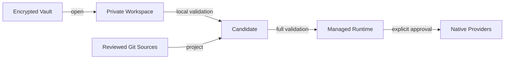

# Tony's Agent Harness

검토된 **Tool, Skill, DAG, Agent 설정**을 암호화된 원본(Vault)에서 검증한 뒤, 각
AI Provider가 읽을 수 있는 런타임 환경으로 안전하게 배포하는 로컬 CLI
도구입니다.

> [!IMPORTANT]
>
> 이 도구는 에이전트의 판단이나 스킬 실행을 대신하지 않습니다.
> 설정의 규격과 계약만 선언하며, 실제 실행과 권한 집행은 각 AI Provider가
> 담당합니다. (Nix는 공개된 빌드·런타임 의존성만 제공합니다.)

## Why Harness?

여러 AI 도구(Codex, Claude 등)를 함께 쓰다 보면 도구마다 설정 위치와 형식이 달라
같은 구성을 반복해서 복사하게 됩니다. 이 과정에서 어떤 파일이 진짜 원본인지
파악하기 어려워집니다.

또한 AI 에 대한 설정을 그대로 버전 관리 시스템(GitHub,GitLab,,,) 에 배포하게되면
회사 혹은 숨겨야하는 코드를 활용하는 스킬과 설정들이 노출될 수 있습니다.

이를 해결하기 위해 본 Harness는
**단일 암호화 Vault**를 진실의 원천(Single Source of Truth)으로 삼아
다음 세 가지 영역을 엄격히 분리합니다.

- **`config` (설정 및 수명주기):** 암호화된 Vault, 로컬 편집용 Workspace, 검증
  후보, 배포된 Runtime 관리
- **`source` (외부 리소스):** 사전에 검토한 특정 Git 커밋에서 가져오는 외부
  Skill·Tool
- **`provider` (연결 경계):** 배포된 Runtime을 읽을 수 있도록 사용자가
  명시적으로 승인한 AI 도구 연결

보안을 위해 외부 Source 버전(pin) 변경이나 Provider 연결은
절대 자동으로 승인하지 않습니다.
또한 Vault 저장과 Runtime 활성화를 별도의 트랜잭션으로 처리하여,
부분 실패를 마치 하나의 완벽한 배포인 것처럼 포장하지 않습니다.

## Quick Start

### 사전 요구사항

- [Nix](https://nixos.org) 및 [just](https://github.com)
- Private Git 저장소를 외부 Source로 쓸 경우 [GitHub CLI (`gh`)](https://github.com) 인증 필요

### 1. 빌드 및 설치

```sh
just
export PATH="$PWD/result/bin:$PATH"

harness --version
harness config status
```

> [!NOTE]
>
> **참고:** GitHub Release에서 Linux/macOS(amd64/arm64)용 단일 바이너리도 받을
> 수 있습니다. 단, 이 바이너리에는 `sops`, `age`, `git`, `gh` 및 검증용 셸
> 도구가 포함되어 있지 않으므로 시스템 `PATH`에 직접 설치해야 합니다. 재현
> 가능한 환경이 필요하면 위의 Nix 빌드를 권장합니다. _(v0 버전대는 아직 하위
> 호환성을 보장하지 않습니다.)_

### 2. 초기화 (최초 1회)

기존 설정 번들 디렉터리를 가져오거나 빈 Workspace로 시작합니다. 이미 Vault나
Workspace가 존재하면 상태를 덮어쓰지 않고 안전하게 중단됩니다.

초기화할 때 `~/.config/tonys-agent-harness/age.key`가 없으면 age 개인키를
자동으로 생성합니다. 기존 키는 검증만 하고 덮어쓰지 않습니다. 이 키를 잃으면
Vault를 복호화할 수 없으므로 Git, Nix, CI에는 넣지 말고 별도의 안전한 위치에
백업하세요.

```sh
harness config init /absolute/path/to/your-configs
# 또는 빈 상태로 시작
harness config init empty
```

### 3. 일상적인 수정 및 배포

편집기에서 설정을 수정하고 닫으면 자동으로 검증, 암호화 저장, Runtime 배포까지 한 번에 진행됩니다.

```sh
harness config edit skill/example
```

### 4. 여러 파일 동시 편집 (고급)

여러 파일을 한꺼번에 수정하거나 배포 전 변경 사항을 미리 검토하려면 Workspace를 직접 엽니다.
`apply`를 실행하면 편집 내용을 저장한 뒤 Workspace를 닫고 Runtime을 갱신합니다.

```sh
harness config workspace open --path
# 출력된 경로에서 파일들을 직접 수정

harness config apply --dry-run  # 변경 사항 미리보기
harness config apply            # 실제 저장 및 배포
```

`apply` 실행 결과는 다음 세 가지 상태로 명확히 구분됩니다.

- `PLANNED`: `--dry-run` 시뮬레이션 완료 (실제 변경 없음)
- `APPLIED`: Vault, Runtime 또는 Provider 연결 중 하나 이상이 갱신됨
- `UP_TO_DATE`: 검증을 통과했으나 변경된 내용이 없음

## Architecture Overview



- **Workspace vs Runtime:** Workspace는 사람이 편집하기 위한 복호화된 평문
  공간이고, Runtime은 AI Provider가 읽어가는 최종 생성물(Materialized
  result)입니다.
- **격리된 외부 Source:** 외부 Git Source는 검증 후보(Candidate) 단계에서만
  병합되며, 사용자의 Vault나 Workspace 원본을 절대 건드리지 않습니다.
- **캐시 및 세대 관리:** 활성 Runtime은 교체가 완료되면 이전 버전을 자동으로
  정리합니다. 반면 외부 Source 캐시는 오프라인 재사용을 위해 유지되므로 필요할
  때 직접 정리하세요.
    ```sh
    harness source cache prune --dry-run
    harness source cache prune
    ```

_(참고: 전역 Nix store는 건드리지 않으므로 시스템의 Nix 도구를 통해 별도로 관리하세요.)_

## CLI Reference

| 명령어                                         | 설명                                                  |
| :--------------------------------------------- | :---------------------------------------------------- |
| `harness config status`                        | 복호화 없이 현재 상태 및 다음 권장 작업 확인          |
| `harness config init PATH\|empty`              | 최초 Vault 및 Workspace 생성                          |
| `harness config edit [kind/id]`                | 특정 설정 편집 후 검증, 저장, 배포 일괄 실행          |
| `harness config apply [--dry-run]`             | 현재 편집 후보 검증 및 Runtime 적용                   |
| `harness config graph [kind/id]`               | Tool, Skill, Agent 간의 의존성 관계 확인              |
| `harness config workspace open\|close`         | 다중 파일 편집을 위한 Workspace 수동 제어             |
| `harness config runtime reset`                 | Vault와 암호화 키는 유지한 채 배포된 Runtime만 초기화 |
| `harness source status\|update`                | 외부 Source 커밋 고정(pin) 상태 확인 및 업데이트      |
| `harness source cache prune`                   | 더 이상 참조하지 않는 외부 Source 캐시 정리           |
| `harness provider status\|connect\|disconnect` | AI Provider의 Runtime 접근 권한 승인 및 해제          |

_(구버전의 `sync`, `unlock`, `lock`, `purge` 명령어는 하위 호환성을 위해 동작하지만, 앞으로는 위 표준 명령어 사용을 권장합니다.)_

### 외부 Git Source 관리

후보 커밋을 확인한 뒤, 검증이 끝난 **전체 커밋 해시(Full SHA)**를 명시적으로 고정합니다.
Git 인증 및 조직 SSO는 시스템의 credential helper에 위임합니다.

```sh
gh auth status
gh auth setup-git

harness source update SOURCE
harness source update SOURCE REVIEWED_FULL_SHA
harness config apply --dry-run
harness config apply
```

> 외부 저장소의 접근 권한이 철회되더라도 로컬 캐시는 자동으로 지워지지 않습니다.
> 삭제가 필요하면 `source cache prune`을 실행하세요.

### AI Provider 연결 관리

Provider는 단순 설정 데이터가 아니라 **Runtime 접근에 대한 별도의 보안 승인 경계**입니다.
연결 전 상태를 확인하고, 쓰지 않는 도구는 반드시 연결을 해제하세요.

```sh
harness provider status
harness provider connect codex
harness provider disconnect codex
```

## Security & Safety

암호화에는 [SOPS](https://github.com)와 [age](https://github.com)의 공식 CLI를 사용합니다.

- **민감 정보 격리:** `age` 개인키, 평문 Workspace, Source 레지스트리 및 캐시는
  Git이나 공개 Nix 입력에 절대 포함되지 않습니다.
- **엄격한 Source 검증:** 외부 Source는 HTTPS 기반 GitHub URL과 검토된 Full
  Commit SHA만 허용합니다.
- **무실행 검증:** 검증 과정 중 사용자의 Skill 스크립트, 플러그인, OAuth, Hook
  등을 절대 임의로 실행하거나 설치하지 않습니다.
- **안전한 롤백 보장:** 후보 검증에 실패하면 기존의 암호화 데이터(Ciphertext)와
  현재 활성화된 Runtime을 그대로 유지합니다.
- **데이터 보존 복구:** `runtime reset`은 배포된 Runtime만 정리할 뿐, 원본
  Vault나 Workspace, 암호화 키는 삭제하지 않습니다.
- **충돌 방지:** Provider 디렉터리에 충돌이나 외부 변경(drift)이 감지되면 사용자
  승인 없이 기존 파일을 덮어쓰지 않습니다.

## Development

전체 공개 의존성 검증, 테스트, 빌드를 한 번에 실행합니다.

```sh
just
```

코어 로직 수정 후 빠른 회귀 테스트(단위, 통합, CLI/Bash/Nix 시나리오, 성능 측정)를 돌릴 때는 `task`를 사용합니다.

```sh
task core
task core:perf   # Linux perf 기반 측정 (선택)
task core:trace  # Linux bpftrace 기반 추적 (선택)
```

_(성능 수치는 동일한 장비와 fixture에서의 전후 비교용이며, 다른 환경에 적용하는 절대 기준으로 삼지 않습니다.)_

## Contributing

Issue 제보와 Pull Request를 환영합니다.

1. **사전 논의:** 코드를 수정하기 전에 해결하려는 문제, 기대 동작, 보안 경계에 미치는 영향을 먼저 설명해 주세요.
2. **테스트 데이터:** 테스트 시 실제 개인 설정이나 자격증명 대신 반드시 가상의 합성(synthetic) fixture를 사용하세요.
3. **PR 작성:** 사용자 동작의 변화, 실행한 검증 명령어와 결과, 그리고 남아 있는 잠재적 위험 요소를 명시해 주세요.
4. **필수 검증:** PR 병합 전 아래 명령어가 모두 통과해야 합니다.
    ```sh
    just       # 공개 경계, 전체 테스트, secret scan, 빌드
    task core  # 코어 단위·통합·시나리오·성능 회귀 테스트
    ```

> [!IMPORTANT]
>
> **보안 취약점 제보:** 보안 취약점이나 민감한 정보 유출 문제는 공개 Issue에
> 올리지 마시고, 저장소의 **Security 탭(Private vulnerability reporting)**을
> 통해 비공개로 제보해 주세요.

## Release

릴리스 태그는 저장소의 버전 메타데이터와 일치하는 `vMAJOR.MINOR.PATCH` 형식을 따릅니다.
릴리스 커밋에서 `just` 검증을 마친 뒤 annotated tag를 push하면
GitHub Actions가 자동으로 플랫폼별 바이너리 압축 파일, 체크섬, 릴리스 노트를 생성합니다.

_(이미 게시된 태그와 빌드 산출물은 덮어쓰지 않으며, 수정 사항이 생기면 반드시 새 패치 버전으로 릴리스합니다.)_

```sh
just
git tag -a v0.0.1 -m "v0.0.1"
git push origin v0.0.1
```

## License

[MIT](./LICENSE)
