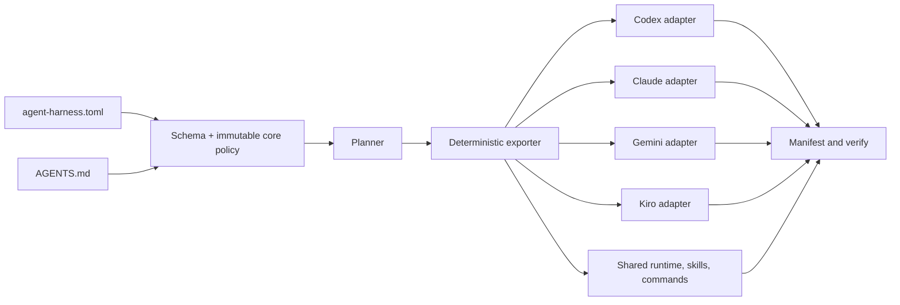

# Tony's Agent Harness

A provider-neutral engineering harness that turns one project manifest into
reviewable Codex, Claude, Gemini, and Kiro configuration—without letting a
provider adapter weaken the shared safety policy.

## About

Tony's Agent Harness packages three things that are often scattered across
agent configuration:

- a small, human-editable project contract in `agent-harness.toml`;
- deterministic policy and workflow assets shared by every provider;
- exporters and verification that make provider-specific files reproducible.

The CLI generates configuration; it does **not** activate it, deploy
infrastructure, migrate data, push commits, or read secrets. The optional Home
Manager module is an explicit activation adapter for managed user environments.
External and destructive actions remain protected by their own approval
boundary.

The current MVP supports Python 3.11+ and Nix, with exporters for Codex,
Claude, Gemini CLI, and Kiro.

## Why

Agent setups tend to drift when each provider gets its own copied rules. They
also become hard to audit when probabilistic judgement is used as an authority
for security-sensitive actions.

This project keeps the model simple:

1. `AGENTS.md` is the provider-neutral behavior contract.
2. `agent-harness.toml` selects a preset, providers, roles, and stricter local
   policy.
3. Deterministic gates enforce non-negotiable controls such as secret denial,
   read-only reviewers, scoped approvals, retry limits, and completion evidence.
4. Provider exporters adapt syntax and capabilities without redefining policy.
5. `verify` detects missing, unexpected, stale, or modified generated files.

An LLM or Judge may recommend a route, but it cannot override a deterministic
block or manufacture approval.

## How to start

### With Nix

```bash
git clone https://github.com/vanillacake369/tonys-agent-harness.git
cd tonys-agent-harness

# Check the local runtime, then test the repository.
nix run . -- doctor
nix flake check

# Initialize a consuming project. Existing manifests are never overwritten.
nix run . -- init --preset infra-devops --project /path/to/project

# Preview first; plan is read-only.
nix run . -- plan --project /path/to/project

# Generate an owned staging bundle and verify it byte-for-byte.
nix run . -- export \
  --project /path/to/project \
  --output /path/to/project/build/agent-harness
nix run . -- verify \
  --project /path/to/project \
  --output /path/to/project/build/agent-harness
```

### With Python

The CLI itself uses only the Python standard library:

```bash
python3 harness.py doctor
python3 harness.py init --preset infra-devops --project /path/to/project
python3 harness.py plan --project /path/to/project
python3 harness.py export --project /path/to/project
python3 harness.py verify --project /path/to/project
```

Without `--output`, generated files are written below the selected project at
`build/agent-harness`.

Generated governance scripts also expect common engineering tools such as
`bash`, `git`, `jq`, and `openssl` when the corresponding gates run.

### Choose a preset

| Preset | Intended use |
| --- | --- |
| `minimal` | Small local projects with the mandatory safety baseline |
| `application` | Product/application development and review |
| `infra-devops` | Infrastructure-heavy work with operational safeguards |
| `regulated` | All providers and the strictest bundled workflow profile |

After initialization, edit only the project-owned `agent-harness.toml`.
Project settings may make policy stricter, but cannot relax the mandatory core.

## Public workflow

Most users need only four public commands; lifecycle skills are composed behind
them.

| Command | Use it for |
| --- | --- |
| `cmd-vpp-work-ljh` | Route ordinary work by risk, uncertainty, and blast radius |
| `cmd-vpp-comment-ljh` | Add scoped comments or explain a change |
| `cmd-vpp-handoff-ljh` | Produce a reproducible engineering handoff |
| `cmd-vpp-ship-ljh` | Prepare an approved release without executing it |
| `cmd-post-blog-ljh` | Write a Korean technical blog through phased specification and approval |

The `skl-pre-*`, `skl-mid-*`, `skl-phase-*`, and `skl-post-*` assets under
`assets/skills/` are internal lifecycle and content capabilities. Projects normally invoke
the command facade rather than selecting those skills directly.

## Architecture



| Boundary | Responsibility | Source of truth |
| --- | --- | --- |
| Behavior | Durable provider-neutral operating rules | `AGENTS.md` |
| Product specification | Requirements, ADRs, tests, traceability | `docs/agent/` |
| Configuration | Project choices and stricter controls | `agent-harness.toml` |
| Core policy | Controls a project cannot weaken | `core/policy.toml` |
| Capability model | Provider support and adaptation status | `core/providers.toml` |
| Assets | Public commands and composed lifecycle skills | `assets/` |
| Enforcement | Approval, sandbox, evidence, retry, and lifecycle gates | `runtime/` |
| Export edge | Deterministic provider rendering and verification | `harness.py` |
| Distribution | Nix app/package and Home Manager module | `flake.nix`, `nix/` |

Export is intentionally separate from activation. The exporter writes only to
the requested output directory, marks ownership in `manifest.json`, and refuses
to replace unmanaged content. Consumers can install a verified bundle using
their own adapter or enable the supplied Home Manager module.

The executable Nix/Home Manager adapter lives under `nix/agents/`. It installs
the shared runtime, provider bridges, public commands, internal lifecycle
skills, and deterministic gates from this repository rather than copying them
into each consumer.

### Provider support

| Provider | Export status | Instruction bridge |
| --- | --- | --- |
| Codex | Supported with adapted hooks | Exported `AGENTS.md` |
| Claude | Supported | `CLAUDE.md` imports exported `AGENTS.md` |
| Gemini CLI | Adapted | `context.fileName` loads exported `AGENTS.md` |
| Kiro | Adapted | Exported `AGENTS.md` plus native workflow/agent files |

“Supported” means the adapter is generated and covered by repository tests; it
does not prove that a particular locally installed provider version accepts the
configuration. Run `doctor`, the exported provider instruction gate, and the
provider-native conformance script in the consuming environment before
activation. An unavailable provider must be reported as unverified, not passed.

## Development and verification

```bash
# Focused test suite
python3 -m unittest discover -s tests -v

# Syntax check
python3 -m compileall -q harness.py runtime/governance tests

# Nix packaging and repository checks
nix flake check

# Whitespace and patch hygiene
git diff --check
```

Runtime telemetry, memory, generated bundles, approval receipts, review
receipts, raw evidence, credentials, and local caches are not source artifacts
and must not be committed. Keep approval and review receipts outside the
repository; the gates enforce that boundary at runtime.

## FAQ

### Does this replace each provider's native sandbox?

No. The harness separates sandbox boundaries from approval decisions and emits
provider-native adapters where supported. Hooks add enforcement and evidence,
but are not treated as the only security boundary.

### Can a project turn off production or destructive approval?

No. Project policy may be stricter than the mandatory core, never weaker.
Malformed, missing, conflicting, or unknown policy fails closed.

### Why generate files instead of maintaining four configurations?

Generated adapters make provider differences explicit while keeping one
behavioral contract. Their inventory, digest, contents, and executable modes
can then be verified deterministically.

### Does `export` install or activate the generated bundle?

No. It writes an owned staging directory only. Activation is deliberately left
to the consumer so that repository generation cannot silently mutate a user or
production environment.

### Where do project specs belong?

Under the consuming project's `docs/agent/` directory. Markdown is the
specification source of truth; traceability TSV files link requirement IDs to
design, implementation, tests, and verification evidence.

### Are all provider capabilities equivalent?

No. `core/providers.toml` records whether a capability is supported or adapted.
Verification must fail rather than silently omit mandatory enforcement.

### Can an LLM Judge authorize a deployment or destructive command?

No. A Judge can classify or recommend. Deterministic policy and a scoped,
externally stored human approval receipt remain authoritative.

### What is intentionally not included yet?

Hosted telemetry, dashboarding, automatic Skill ROI tuning, and release
execution are outside the current boundary. Provider activation is available
only through the explicitly enabled Home Manager adapter.

## License

Licensed under the [MIT License](LICENSE). You may use, copy, modify, merge,
publish, and distribute the software under its terms. Provider products and
their trademarks remain the property of their respective owners.

Security issues should be reported through GitHub's private vulnerability
reporting flow as described in [SECURITY.md](SECURITY.md).
